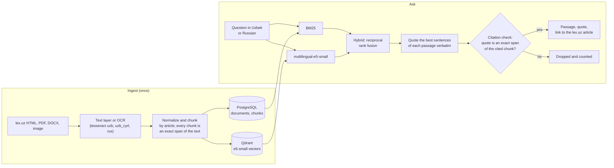

# DocuMind UZ

Ask a question about Uzbek law in Uzbek or Russian and get the exact passage of the law
that answers it: a verbatim quote, checked against the source text, with a link to the
article on lex.uz.

<!-- DEMO GIF: 30-second screen recording goes here, e.g.
<p align="center"></p>
-->

## Quick start

Needs Docker with the Compose plugin. Everything runs locally; the site is served on
`127.0.0.1` only.

```bash
git clone https://github.com/sherzodbek-fozilov/documind-uz.git && cd documind-uz
cp .env.example .env    # set POSTGRES_PASSWORD and DOCUMIND_API_DB_PASSWORD
docker compose build
docker compose run --rm ops python scripts/fetch_sources.py --keep-registry --delay 30
docker compose run --rm ops documind ingest data/raw
docker compose up -d    # then open http://127.0.0.1:8080
```

The fetch step downloads the approved lex.uz pages politely (robots.txt, one request at a
time, a pause between requests). The default retriever is BM25; for the hybrid retriever
run `docker compose run --rm ops python scripts/download_model.py` and set
`DOCUMIND_API_RETRIEVER=hybrid` in `.env`. Server setup with HTTPS and the public demo
mode: [`docs/deploy.md`](docs/deploy.md).

## How it works



No language model is needed: by default the answer is the quoted passages themselves.
An optional LLM mode can phrase an answer, but its citations go through the same exact-span
check, and citations that fail it are dropped.

## Results

All numbers are read from `results/*.json`, which are written by the evaluation scripts.
The tables are regenerated with `python scripts/render_readme.py`; missing values are `TBD`.

<!-- BEGIN METRICS (generated by scripts/render_readme.py, do not edit) -->
### Retrieval: real documents (test split, main result)

| Method | Recall@1 | Recall@5 | Recall@10 | MRR | Questions |
|---|---|---|---|---|---|
| BM25 | TBD | TBD | TBD | TBD | TBD |
| multilingual-e5-small (dense) | TBD | TBD | TBD | TBD | TBD |
| Hybrid BM25 + e5 (RRF) | TBD | TBD | TBD | TBD | TBD |
| Hybrid + reranker | TBD | TBD | TBD | TBD | TBD |
| Fine-tuned e5-small (dense) | TBD | TBD | TBD | TBD | TBD |
| Hybrid with fine-tuned e5 (RRF) | TBD | TBD | TBD | TBD | TBD |

Shown once at least 80 labeled real questions exist; pilot results on smaller samples are in `docs/experiments.md`.

### Retrieval: SYNTHETIC sanity set (test split, search within the gold document; not comparable to the real set)

| Method | Recall@1 | Recall@5 | Recall@10 | MRR | Questions |
|---|---|---|---|---|---|
| BM25 | 0.797 (0.73–0.86) | 0.985 (0.96–1.00) | 1.000 (1.00–1.00) | 0.880 (0.84–0.92) | 133 |
| multilingual-e5-small (dense) | 0.827 (0.76–0.89) | 0.977 (0.95–1.00) | 1.000 (1.00–1.00) | 0.890 (0.85–0.93) | 133 |
| Hybrid BM25 + e5 (RRF) | 0.827 (0.76–0.89) | 1.000 (1.00–1.00) | 1.000 (1.00–1.00) | 0.902 (0.87–0.94) | 133 |
| Hybrid + reranker | TBD | TBD | TBD | TBD | TBD |
| Fine-tuned e5-small (dense) | TBD | TBD | TBD | TBD | TBD |
| Hybrid with fine-tuned e5 (RRF) | TBD | TBD | TBD | TBD | TBD |

Values in parentheses: 95% bootstrap confidence interval over questions.

### Other measurements

| Measurement | Value | n | Source file |
|---|---|---|---|
| OCR CER, synthetic scans, uz-Latn | 0.1% | 8 | `results/ocr_synthetic.json` |
| OCR CER, synthetic scans, uz-Cyrl | 0.7% | 8 | `results/ocr_synthetic.json` |
| OCR CER, synthetic scans, ru | 0.6% | 8 | `results/ocr_synthetic.json` |
| Citation correctness (exact span), real questions | 100.0% | 105 | `results/citations_real.json` |
| Citation correctness (exact span), SYNTHETIC questions | 100.0% | 376 | `results/citations_synthetic.json` |
| Answer latency p50, CPU (s) | TBD | TBD | `results/latency.json` |
<!-- END METRICS -->

**In short** (from [`docs/experiments.md`](docs/experiments.md); the real-question table
above stays `TBD` until at least 80 questions are labeled):

- On the 49 frozen real test questions (eval set v1: 24 Uzbek Latin, 23 Russian, 2 Uzbek
  Cyrillic), the hybrid retriever finds the right passage in the top 5 for **0.35** of
  them (95% CI 0.22–0.49). The intervals of BM25, e5 and hybrid overlap, so the methods
  are not ranked yet.
- **Uzbek is the weak side.** e5 alone reaches Recall@5 0.48 on the Russian questions but
  0.08 on the Uzbek (Latin) ones; hybrid 0.43 vs 0.29.
- **Fine-tuning did not help:** e5-small fine-tuned on title-style pairs got worse on real
  questions (Recall@5 0.265 → 0.122; 95% paired interval of the difference −0.265 to
  −0.020), although its validation score improved.
- Citation correctness is 100% by construction in extractive mode (quotes are cut from the
  chunk); the check guards against offset bugs and matters for the LLM mode.

## Limitations

- **Small test set:** 49 real questions on two acts of Uzbekistan (each in its Uzbek
  and Russian version); intervals are wide, and only 2 questions are in Uzbek Cyrillic.
- **Uzbek retrieval is weak**, especially for the dense model (see above).
- **Dialects and mixed Uzbek–Russian questions are not solved:** the 9 questions tagged
  `mixed-uz-ru` were found in the top 5 (chunk level) at most once by any method.
- **OCR is measured on synthetic scans only**, which are cleaner than real ones.
- **lex.uz states no license** and nothing about automated download or copying (checked
  and recorded in [`docs/data.md`](docs/data.md)); whether a public demo may show quotes
  is not decided yet.
- **Do not expose the API without authentication while uploads are enabled:** there are no
  user accounts, and uploaded files are parsed inside the API process. The public demo
  mode (`DOCUMIND_PUBLIC_DEMO=true`) disables uploads and keeps the corpus read-only.

## Related work

Commercial assistants for Uzbek legislation exist (for example Tuzuk,
which advertises document analysis, drafting and consultations citing
lex.uz), and recent research reports a legal Uzbek retrieval benchmark
and an embedder (arXiv 2608.29284). This project does not compete with
them: it is an open, reproducible retrieval pipeline over the legislation of
Uzbekistan (Uzbek and Russian versions) with exact, machine-verified quotes,
a frozen evaluation set of real questions written by the author, and a
documented negative fine-tuning result.

## Data and licenses

- **Legislation of Uzbekistan from lex.uz:** Civil Code part 2 and Labor Code 2022, each
  in its Uzbek (Latin) and Russian version. Fetched only after their terms were checked; every source is listed with
  URL, date and sha256 in [`docs/data.md`](docs/data.md).
- **Synthetic contracts** for OCR and format tests are marked synthetic in their text,
  file names and database, and reported separately.
- **Nothing is redistributed:** downloaded documents and training pairs are git-ignored;
  only ids, URLs, license notes and hashes are committed. No personal data is used.
- Code: MIT. Note that PyMuPDF is AGPL-3.0.

Implemented with [Claude Code](https://claude.com/claude-code) under my direction; the
evaluation design, question labeling and decisions are mine.

## Roadmap

From [`docs/issues.md`](docs/issues.md), in order:

1. A dev question set from train chapters, used for all tuning and model selection
   (never the test set).
2. Eval set v2: new real test questions, frozen like v1 and reported separately.
3. Screen off-the-shelf Uzbek embedding models on v1 and report every one tried.
4. A held-out third act (consumer protection law) as an out-of-domain test set.
5. Optional cross-encoder reranker, with its CPU latency measured.
6. Authentication and sandboxed parsing of uploads before uploads are offered publicly.
7. A concrete LLM provider with a per-request token limit and a monthly budget guard.

More: [development guide](docs/development.md) · [design decisions](docs/decisions.md) · [experiments](docs/experiments.md) ·
[deployment](docs/deploy.md) · [fine-tuning runbook](docs/finetune-runbook.md) ·
[frontend](frontend/README.md)
