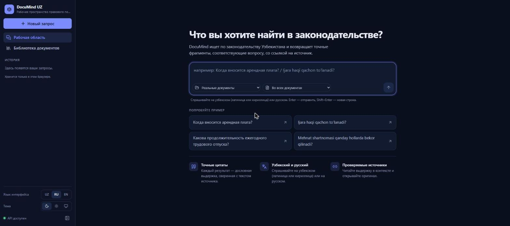
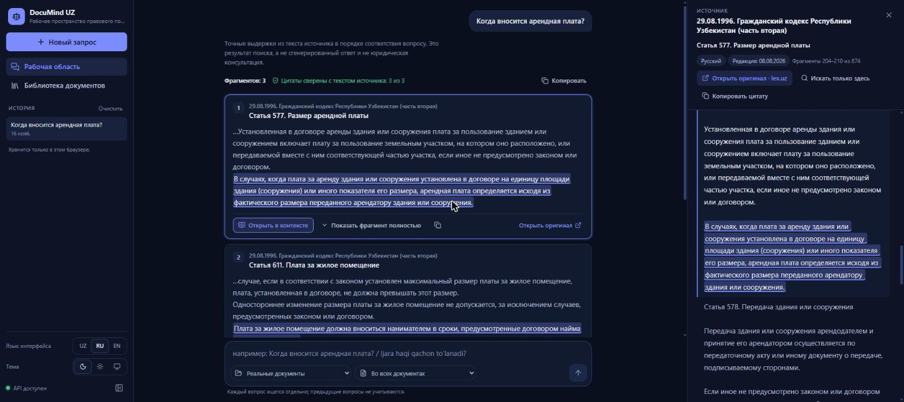
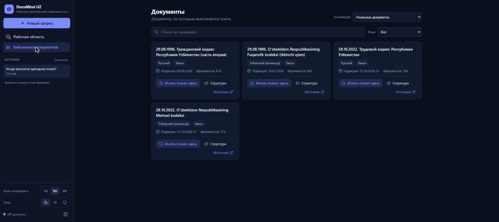
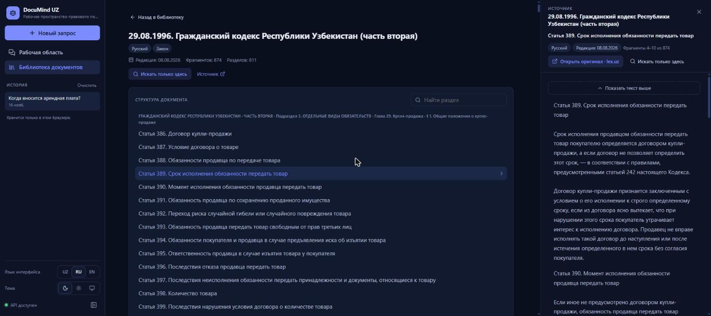
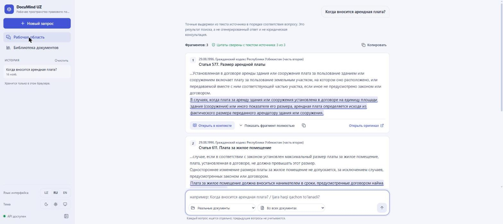
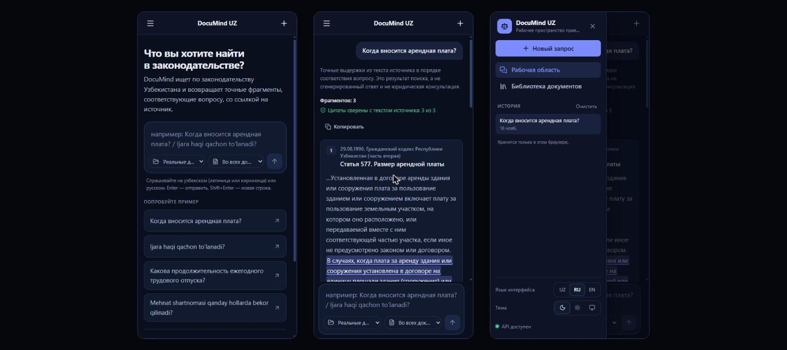

# Frontend

React + TypeScript (Vite) workspace for the DocuMind UZ API: ask a question, read the
passages that match it with the exact quote highlighted, open a quote in its context, and
browse the documents the search runs over. The UI language can be switched between Uzbek,
Russian and English; questions are asked in Uzbek (Latin or Cyrillic) or Russian.

| | |
|---|---|
|  |  |
|  |  |
|  |  |

Screenshots are of the running app against the local API with the real corpus.

## Run

```bash
# 1. the API (from the repository root; needs an ingested corpus, see docs/development.md)
documind serve                 # http://127.0.0.1:8000

# 2. the UI (from frontend/)
npm install        # npm 11+ (npm 10 cannot resolve vitest's optional peers)
npm run dev        # http://localhost:5173, /api/* is proxied to the API
npm test           # vitest, handwritten samples only
npm run typecheck
npm run build      # static files in dist/
```

The dev server forwards `/api/*` to `http://127.0.0.1:8000`, so the API needs no CORS
settings; set `DOCUMIND_API_URL` to point the proxy elsewhere. A built bundle calls
`VITE_API_BASE` (default `/api`), which the reverse proxy in front of it must route to the
API. No LLM key is needed: the default extractive mode returns verbatim quotes.

## What the UI does

- **Sidebar**: new query, workspace / library navigation, query history, interface
  language, theme (dark by default, light, system), API status; collapses to an icon rail
  and becomes a drawer on phones and tablets.
- **Workspace**: a start screen with example questions, then a thread of questions and
  results. In extractive mode the passages are shown as search results; an answer text is
  shown only when the API returns `answer` (LLM mode), and nothing is composed in the
  browser. Each source card has the document, the article, the highlighted quote, "show
  full passage", "view in context", "copy quote" and the link to the original.
- **Technical details**: chunk ids, anchors, answer mode, retriever and the citation check
  are in a closed disclosure under each result; the document and chunk counts are behind
  the API status in the sidebar.
- **Source viewer** (right panel, a drawer on smaller screens): the cited passage inside
  the text around it, from `GET /documents/{id}/passages`; the quote is highlighted by its
  offsets, earlier and later text is loaded on request, and the header links to the
  original (lex.uz). If the server does not have that endpoint, only the cited passage is
  shown, with a note.
- **Document library**: title search, language and type filters (built from the data; a
  filter with one option is not shown), collection switch, document cards with edition
  and passage count, "search only here", and the document structure from
  `GET /documents/{id}/outline`, where a section opens in the source viewer.
- **History**: kept in this browser's `localStorage` only (at most 30 sessions, results as
  the API returned them); there is no account or server-side storage, and the UI says so.
- **States**: skeletons while loading, empty states, and an error message with the
  server's reason and a retry for: API unreachable, nothing ingested (503), unknown
  document (404), rejected question (422), server error.
- **Accessibility**: landmarks and labels, visible focus, `aria-pressed` / `aria-current`
  / `aria-expanded` states, Enter to ask and Shift+Enter for a new line, Escape closes the
  drawer and the source viewer, reduced motion is respected.

Text from the API is always rendered as text (never as HTML), and only `http(s)` URLs
become links.

## Layout of the code

| Path | Contents |
|---|---|
| `src/App.tsx` | the shell and the page state: health, documents, collection and scope, the thread, history, the source viewer |
| `src/api/types.ts` | response types, mirroring `documind/api/schemas.py` |
| `src/api/client.ts` | `fetch` wrapper; maps failures to `ApiError` kinds for the UI |
| `src/components/Sidebar.tsx`, `SearchHistory.tsx`, `SettingsPanel.tsx`, `LanguageSwitch.tsx`, `StatusBar.tsx` | navigation, history, language and theme, API status |
| `src/components/WelcomeScreen.tsx`, `QueryComposer.tsx`, `ChatWorkspace.tsx` | start screen, question input with collection and scope, the thread |
| `src/components/AnswerMessage.tsx`, `SourceCard.tsx`, `CopyButton.tsx` | one result: answer (if any), source cards, technical details |
| `src/components/SourceViewer.tsx` | the cited passage in its context |
| `src/components/DocumentLibrary.tsx`, `DocumentDetails.tsx` | document cards with search and filters; one document and its structure |
| `src/components/ErrorMessage.tsx`, `Skeleton.tsx` | error and loading states |
| `src/state/history.ts`, `src/state/theme.ts` | query history and theme, both remembered in the browser |
| `src/lib/highlight.ts` | splits a passage around its exact quote; never highlights a non-exact span |
| `src/lib/section.ts`, `url.ts`, `clipboard.ts` | heading paths, http(s)-only links, copying |
| `src/i18n/` | UI strings (uz, ru, en), language choice remembered in the browser |
| `src/styles.css` | design tokens (two themes) and all styles; no CSS framework |
| `src/test/` | handwritten sample passages and documents, test helpers |

Dependencies: React and `lucide-react` (icons). Styling is plain CSS on custom
properties, and motion is CSS only.

## Not done yet

- Uploading documents from the UI (the API has `POST /documents/upload`; the UI has no
  form for it, and the "user" collection is not selectable).
- The source viewer shows a document as its consecutive passages; it has no per-paragraph
  links to lex.uz (the API returns an anchor only for the cited quote).
- History is per browser; there are no accounts or shared sessions.
- Each question is searched on its own: there is no multi-turn context.
